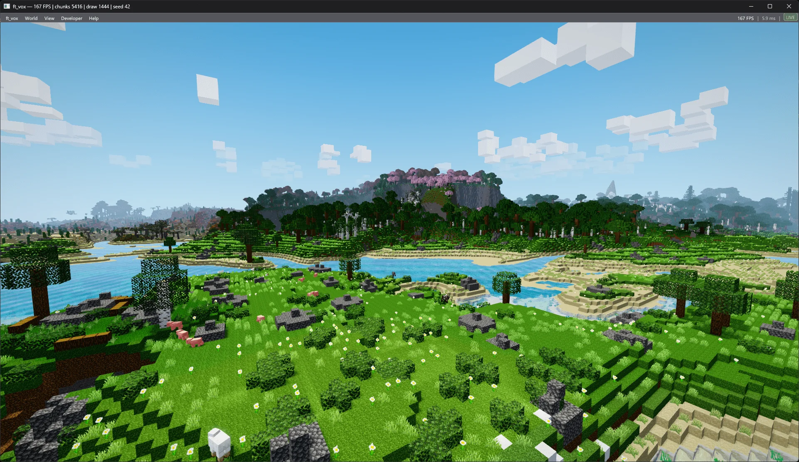
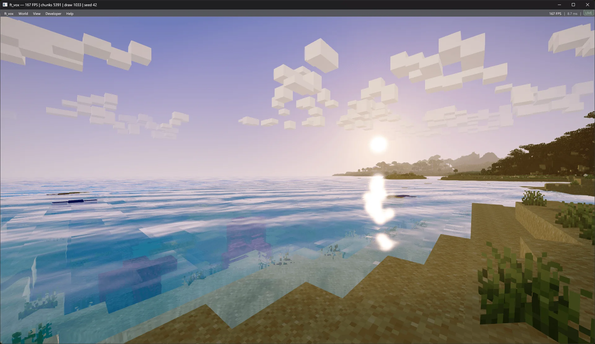
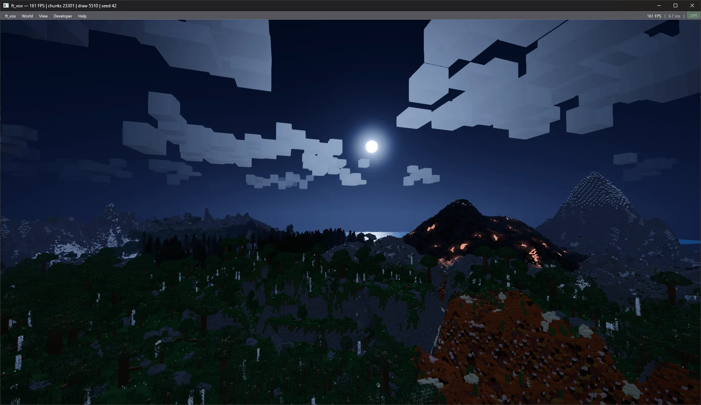
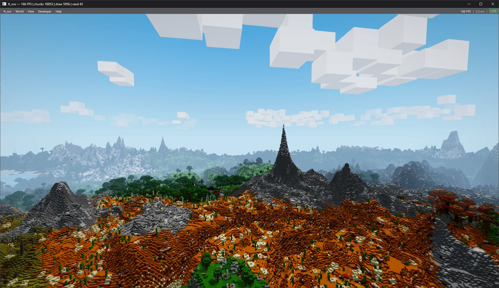
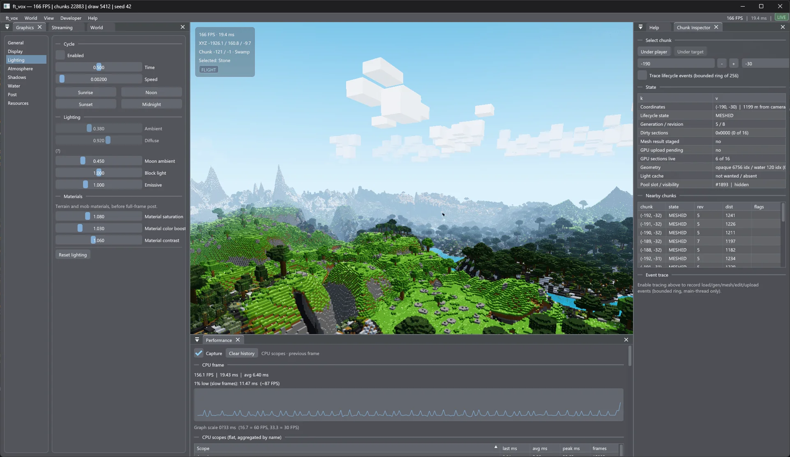

# ft_vox

Cross-platform voxel sandbox engine built from scratch in **C++20**, **Vulkan** and **SDL3**.

<p align="center">
  
</p>


ft_vox is a voxel sandbox engine focused on real-time rendering, procedural
terrain generation and engine architecture.

It features infinite terrain, biome generation, player physics, dynamic
lighting, water, HDR post-processing, passive wildlife, persistent world
saves, server-authoritative multiplayer, in-game server hosting, profiling
and automated visual-regression testing.

## Features

### World
- Infinite procedural terrain with biomes, caves and rivers
- Distance-based chunk streaming with LOD meshing
- Persistent world saves for voxel edits and world state
- Resource-pack support for block textures

### Rendering
- Vulkan 1.2 renderer with dedicated shadow, opaque, water, sky and post passes
- Dynamic cascade shadows with PCF filtering
- HDR post stack: bloom, god rays, ACES tonemapping, optional FXAA
- Full day/night cycle

### Engine
- Player controller on a shared voxel collision solver
- Passive wildlife (cow, pig, sheep, chicken) with ambient wander AI
- Optional Developer UI with graphics, streaming, world map and chunk inspector panels (F1 or `--dev-ui`)
- CPU workload telemetry and GPU frame profiling
- Automated offscreen visual-regression tests

### Multiplayer
- Separate CPU-only dedicated server (`ft_vox_server`) with authoritative UDP gameplay
- Client-side movement prediction and reconciliation, interest-scoped world and entity replication
- Persistent player identities, positions, inventories and shared world edits
- Dockable Multiplayer panel: join, reconnect, saved profiles and favorite endpoints
- In-game private server hosting with configurable player capacity, streaming and graceful checkpoint-confirmed shutdown
- Per-client ping, snapshot age/loss, prediction and traffic diagnostics; authoritative hosted-server roster and health metrics
- Durable automatic world ownership, local admin delegation, kick/ban, allowlist and audit history

## Screenshots

| Sunset | Night |
|--------|-------|
|  |  |

**Long render distance**



## Technical highlights

ft_vox is also an experimentation ground for modern C++ and real-time
graphics engineering.

- Modular Vulkan renderer with an explicit pass graph
- GPU memory management with VMA; texture arrays and greedy meshing
- Asynchronous chunk streaming: thread-pool generation and meshing, staged uploads
- Procedural terrain generation with FastNoise2 noise and biome graphs
- One voxel collision solver shared by the player and passive mobs
- Decoupled simulation and rendering, with graphics-free server and headless targets
- Bounded, versioned UDP transport and private inherited IPC for local administration
- CPU workload telemetry (`FT_VOX_TELEMETRY`) and GPU timestamp profiling
- Automated offscreen visual-regression harness with golden references
- Cross-platform dependency management: vcpkg, system packages and FetchContent



## Quick start

### Linux

```bash
./install_dep.sh
make
./build-vk/ft_vox
```

### Windows

```powershell
.\build.ps1
.\build\Release\ft_vox.exe
```

### macOS

```bash
./install_dep.sh
make
make run
```

For complete build instructions and dependency configuration, see
[Building ft_vox](docs/building.md).

Choose **Local worlds** from the main menu to open a save or create a world.
Press **Escape** in play to pause, save, or return to the menu. To start
directly, use `--world <name>` for a persistent world or `--seed <n>` for a
transient world.

## Multiplayer quick start

From the main menu or Pause, choose **Multiplayer** to open the native Host
and Join screens.

- **Join:** create or select a profile, enter the server address and port,
  and connect. Disconnect, reconnect and switch profiles from the same panel.
- **Host:** select or create a world, choose a profile and server options,
  and click **Start server**. The game supervises a separate
  `ft_vox_server` process and can join automatically. A new world binds
  its primary owner to the selected local profile; existing ownership is preserved.
- **Players / Connection details / Administration:** inspect the live host
  roster or nearby players, view your own connection estimates, and manage
  access on a locally hosted server with verified local permissions.

You can also run a dedicated server without graphics:

```bash
cmake -S . -B build-cpu -DFT_VOX_GRAPHICS=OFF -DCMAKE_BUILD_TYPE=Release
cmake --build build-cpu --config Release --target ft_vox_server
./build-cpu/ft_vox_server --world dev --saves-root ./server-saves --port 7777
```

On Windows with a Visual Studio generator, use
`.\build-cpu\Release\ft_vox_server.exe`.

**Deployment scope:** loopback by default, with explicit opt-in for trusted
private LAN/VPN connections. The gameplay transport does not provide
authenticated encryption or public Internet security. Privileged commands
use a separate local authenticated control channel; remote administration
is not supported.

See the [dedicated server guide](docs/dedicated-server.md),
[multiplayer client guide](docs/multiplayer-client-smoke.md) and
[network security limitations](docs/multiplayer-public-network-readiness.md).

## Controls

Open **Settings** from the main menu or pause menu to change window size, VSync,
anti-aliasing, mouse sensitivity, vertical look direction, or player UI scale.
**Controls reference** shows the keyboard and mouse bindings in-game.

| Input | Action |
|-------|--------|
| WASD / mouse | Move / look |
| Space / Shift | Jump / sprint (up / down while swimming or flying) |
| LMB / RMB | Break / place block |
| E | Open / close inventory |
| 1–9 / wheel | Select a hotbar slot |
| Q | Drop one item from the selected slot |
| T | Cycle creative block in flight |
| V | Toggle walking / debug flight |
| B | Toggle chunk borders |
| C | Release / capture mouse |
| Esc | Open game menu / close inventory |

Flight boost, swimming and all movement modes are detailed in
[player-physics.md](docs/player-physics.md). See the
[inventory controls](docs/game-ui-migration.md#native-player-inventory-304) for mouse and keyboard stack actions.

## Documentation

Detailed technical documentation lives under [`docs/`](docs/):

- [Engine architecture](docs/engine-architecture.md)
- [Simulation / render contracts](docs/simulation-render-contracts.md)
- [Headless simulation runner](docs/headless-runner.md)
- [Dedicated server](docs/dedicated-server.md)
- [Authoritative multiplayer protocol](docs/adr/authoritative-wire-protocol.md)
- [Multiplayer client and hosting guide](docs/multiplayer-client-smoke.md)
- [Multiplayer hosting and recovery validation](docs/multiplayer-hosting-closure.md)
- [Public-network readiness and security limits](docs/multiplayer-public-network-readiness.md)
- [Vulkan renderer](docs/vulkan-graphics.md)
- [Terrain generation](docs/terrain-generation.md)
- [Player physics](docs/player-physics.md)
- [GPU profiling](docs/gpu-profiling.md)
- [Visual regression](docs/visual-regression.md)
- [Workload telemetry](docs/workload-telemetry.md)
- [Building ft_vox](docs/building.md)

## Project status

ft_vox is under active development. The core rendering, terrain, physics and
tooling systems are functional, but APIs, gameplay systems and asset formats
may still change.

Server-authoritative multiplayer is integrated into the game, with a separate
CPU-only dedicated server, persistent world and player state, in-game hosting,
network diagnostics and local administration. The legacy Boost UDP prototype
remains a separate test target; it is not the production gameplay transport.

The current multiplayer scope is trusted private networks, not public Internet
hosting. See the [closure evidence](docs/multiplayer-hosting-closure.md) and
[deployment limits](docs/multiplayer-public-network-readiness.md).

## License

ft_vox is licensed under the [Apache License 2.0](LICENSE).

Third-party components and assets remain subject to their respective
licenses. See [THIRD_PARTY_NOTICES.md](THIRD_PARTY_NOTICES.md) for details.
