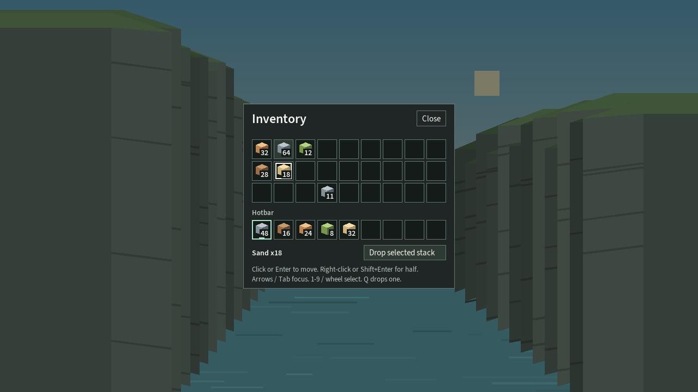
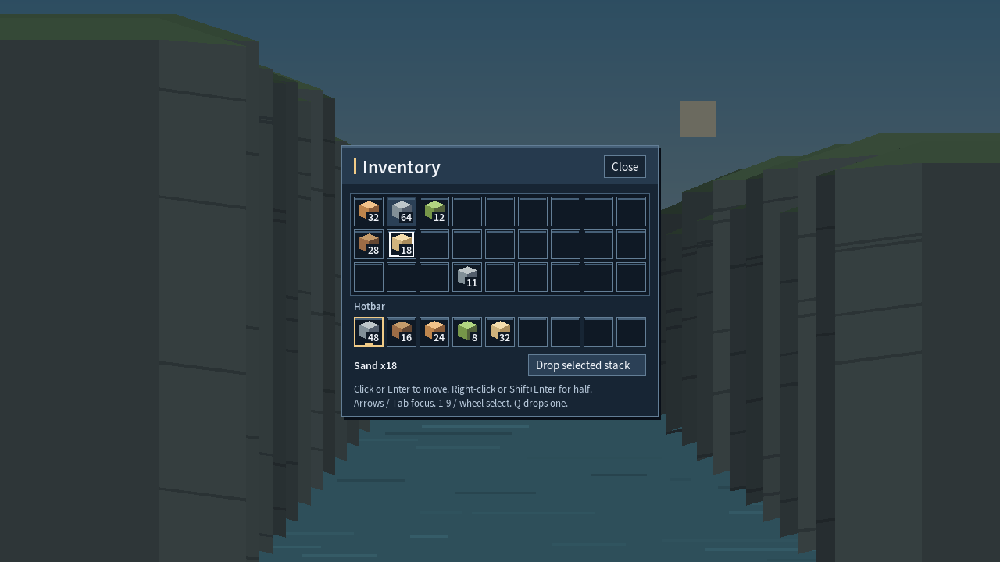
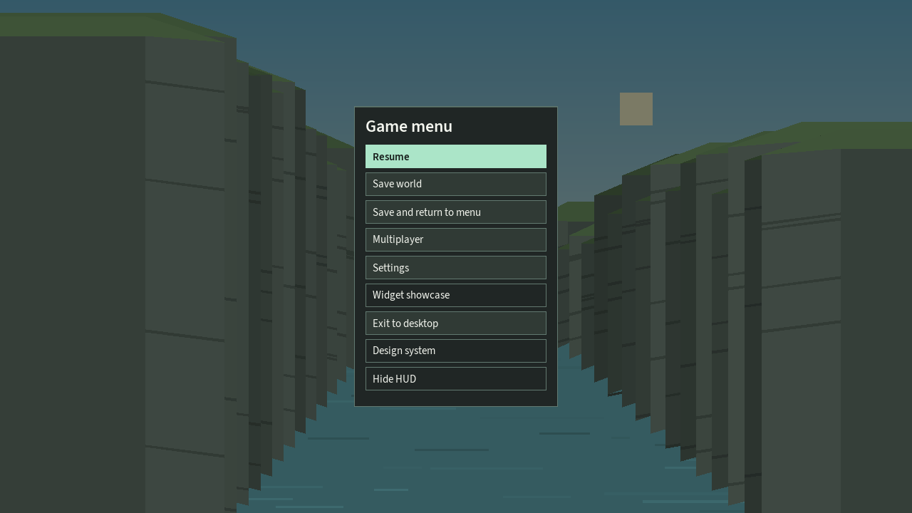
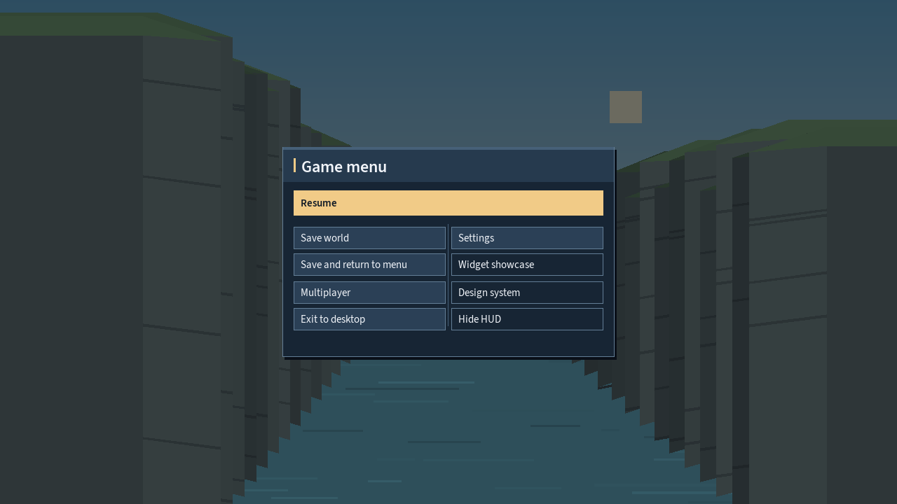
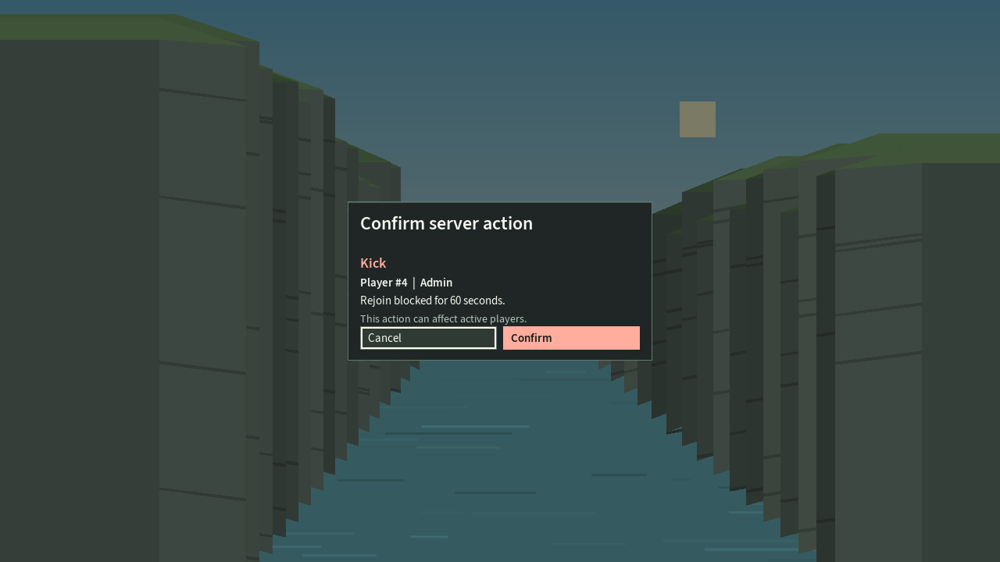
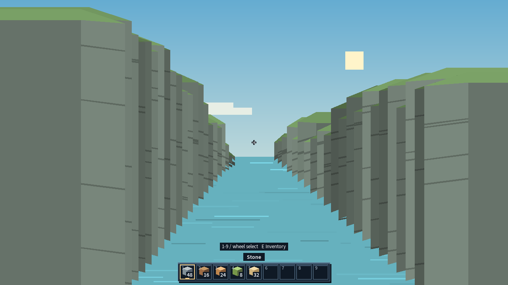
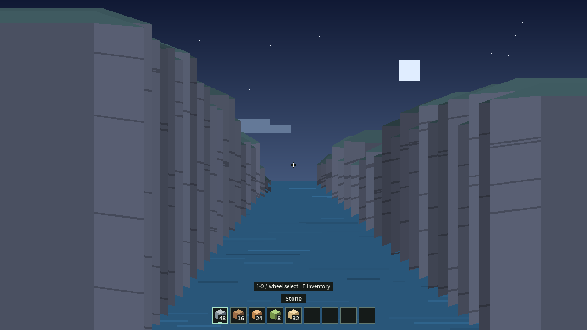
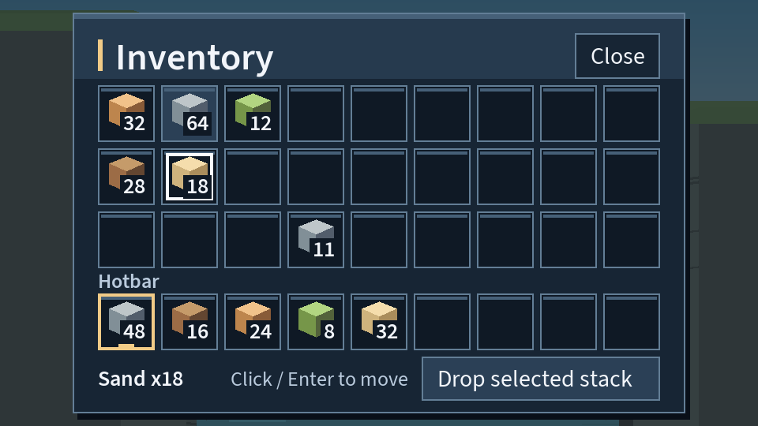
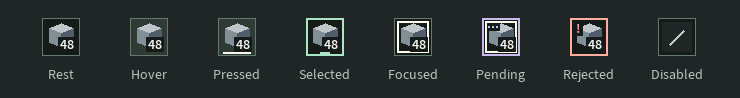

# ft_vox player UI visual direction

[Epic #325](https://github.com/gkehren/ft_vox/issues/325) · [Phase A #326](https://github.com/gkehren/ft_vox/issues/326) · [Epic #298 closure](game-ui-closure.md) · [Current design system](game-ui-design-system.md)

**Slate is the approved direction.** The maintainer selected “Slate, the restrained
graphite direction” in the Phase A review conversation on 2026-11-28.
Slate is the reference for Phase B (#327) and
the later screen passes. The live token contract remains in the current design
system until the tokens are implemented.

## Audit of the running UI

The native captures come from Epic #298 and #304. Menu and Settings observations
also use the local #309 Release proof outputs listed in the reproduction table.
The concept screenshots below use a common illustrative scene. They show design
choices at matching conditions across the two proposals.

| Screen | What the baseline shows | What Slate should improve |
| --- | --- | --- |
| HUD | At the same camera pose, the pale sky can swallow part of the reticle. At night, empty slots recede into the world and selected identity depends on a fine outline. Hints and the selected item name are small and close together. [Day](images/game-ui-closure/player-hud.png) · [Night](images/game-ui-closure/player-hud-night.png) | Use a dual-tone reticle, legible count and label backings, and an independent selection marker. Keep the HUD low against the scene and preserve the dock-safe area. |
| Inventory | The glassy header and instructions take attention before the grid. At 100%, a fine slot outline does much of the work. Focus, rest and selection are easier to distinguish in the 200% capture. The scene area is already free of a character panel. [Standard](images/game-ui-inventory/normal-16x9.webp) · [Held stack](images/game-ui-inventory/held-21x9.webp) · [Compact](images/game-ui-inventory/compact-2x.webp) | Lead with the title and square wells, label and align the hotbar, and move control instructions to a secondary region. Pair selected and focused states with distinct geometry. Keep the held stack and tooltip anchored to the existing input modality and viewport. |
| Launch, Local worlds, Pause | The local `launch.png`, `world-selection.png` and `pause.png` have compact panels and clear outlines. A centered label and similar button treatment give routine navigation, the primary action and utilities almost equal weight. A single saved world sits above several empty rows. | Give each screen a clear task title and primary action. Use a predictable single column and left-aligned labels. Let world results grow within a bounded list and give an empty result its actual empty state. |
| Settings and display confirmation | In `settings.png`, captions and values mostly occupy the same centered text lane. Display, input and preferences look equally weighted. In `resize-preview.png`, requested and current values repeat in a small text block, while the countdown and safe action compete with neighboring text. | Group display and input fields. Align labels and values, with a stacked fit on narrow views. Show the countdown and current/requested values by hierarchy. Keep the safe Revert focus obvious while retaining the existing preview policy. |
| Multiplayer roster and confirmation | The guest roster leaves a large dark area below Back for a two-player snapshot. The read-only explanation, ping/sample age and role details are easy to overlook at compact size. Owner confirmation has an obvious danger button, while the target and lockout read as another line of body text. [Guest](images/game-ui-closure/guest-roster.png) · [Owner](images/game-ui-closure/owner-kick-confirmation.png) | Size the roster to content up to its scroll limit. Distinguish name, role and freshness, and give the read-only explanation a stable place near the list. Emphasize the operation, target and duration in that order. Keep Cancel visibly focused. |
| Gallery | Dense adjacent samples ask the eye to distinguish button borders, validation, toasts and slot states at once. The crafting specimen and confirmation share strong borders with other cards, flattening the reading order. [Crafting specimen](images/game-ui-closure/crafting-gallery.png) | Group related states side by side on a neutral surface. Give each specimen enough room to show its label, focus, state collision and clipped tooltip. Use the same components for gallery and player screens. |

## Comparing the proposals

Both mockups show the same 27 inventory cells, nine hotbar cells, stack counts,
hovered and focused cells, selected Stone, persistent solo pause actions and
owner kick confirmation for Player #4. Day and night use the same camera and
hotbar content. The inventory references informed the square-grid cadence and
the use of panel framing. [Minecraft inventory](https://minecraft.wiki/images/Inventory.png?9e5ea) · [Hytale inventory](https://cms-a.nodecraft.com/f/133932/1282x752/5f38869e53/hytale-inventory.png/m/1000x0/smart)

| Slate · restrained graphite (**approved**) | Strata · layered blue-slate |
| --- | --- |
| Thin single frame, square wells and a mint selection marker. The panel depends on spacing and text weight for structure. Its 388×340 logical footprint and 36-unit cells leave more scene visible. | Framed header rail, recessed group boundary, raised lower tray, gold accents and slot lips. The 406×348 logical layout uses 38-unit cells to make the sections easier to group at a glance. |
| Pause actions read in one column with a clear first action, while utilities use a quieter fill. The compact confirmation leads with the action, target and consequence, then the two buttons. | Pause uses two columns under Resume, which reduces height but changes the scan path. The confirmation uses a separate inset for the target and consequence. |
| HUD consists of individual dark cells and compact label plates. Less framing draws attention to the selected material and game world. | A shared hotbar tray and explicit key labels make controls more discoverable and increase the visual weight at the bottom of the view. |

| Matched specimen | Slate | Strata |
| --- | --- | --- |
| Inventory · 1280×720, 100% |  |  |
| Pause · 1280×720, 100% |  |  |
| Owner confirmation · 1280×720, 100% |  |  |
| Daylight HUD · 1280×720, 100% |  |  |
| Night HUD · 1280×720, 100% |  |  |
| Compact inventory · 960×540, 200% |  |  |
| Ultrawide inventory · 2560×1080, 150% | [Slate at full resolution](images/game-ui-direction/slate-ultrawide.png) | [Strata at full resolution](images/game-ui-direction/strata-ultrawide.png) |

Slate uses the space between the grid, hotbar and action row to show their
relationship. A future crafting or container surface can attach its own titled
slot group using the same pitch, with the player inventory below on compact
views or adjacent where width permits. The standalone inventory remains only
as large as its current contents, with room for real status feedback when it
arrives. Empty slots remain visible. A held stack uses the same cell silhouette,
count and atlas image, then flips and clamps to the visible game view.

## Slate specification

### Color and contrast

Values are sRGB. Use the existing linear compositor to blend translucent layers.
Cards, slot wells, count backings and HUD labels in the mockups use opaque fills.

| Role | Value | Application |
| --- | --- | --- |
| Canvas, base surface | `#141A18`, `#202625` | Opaque menu backdrop where applicable, card face |
| Raised, control | `#2D3531`, `#303A35` | Hovered row or section band, secondary button |
| Sunken | `#151B19` | Inventory wells, tooltip and count plates |
| Border, quiet divider | `#627970`, `#46594F` | Slot and card edges, internal rules |
| Primary, secondary, disabled ink | `#F4F6EF`, `#B7C7BD`, `#84948A` | Text hierarchy and disabled text |
| Selection / action, focus | `#ABE5C8`, `#FFFBEF` | Primary fill, selected accent and keyboard ring |
| On accent and danger | `#151B19` | Dark foreground on filled action buttons |
| Success, warning, error/danger | `#A4DAA8`, `#F3CE82`, `#FFAD9C` | Confirmation, degraded state and rejection or destructive action |
| Info, pending | `#A4CDEA`, `#C9BAED` | Neutral system message and waiting for a result |
| Modal scrim | `#0C1310` at 54% | One dimming layer behind the top modal |
| HUD label backing | `#151B19` opaque | If a later proof warrants translucency, use at least 94% opacity |
| Reticle | `#FFFBEF` over `#0C1310` | Light 1-unit core over a 3-unit dark outline, centered on the projection |

Require at least 4.5:1 for normal, secondary and count text and 3:1 for large
text, operative borders and focus indicators against adjacent surfaces.
Calculated Slate examples include 14.12:1 for primary ink on card, 6.69:1 for
secondary ink on button, 3.73:1 for a slot border against its well, 3.29:1
for a control boundary against the card and 11.39:1 for focus against a
secondary button. The quiet divider is decorative. It never identifies a
control by itself. At 94% opacity over pure white in linear light, the HUD
backing yields 8.06:1 for primary and 4.99:1 for secondary text. Use these
extremes for automated coverage, then inspect bright and dark gameplay for
icons and the dual-tone reticle. Disabled controls use an explicit visual
cue and maintain readable explanatory text.

### Type, spacing and icons

- **Face.** The concepts use Source Sans 3 Regular for labels and Semibold for
  titles and quantities. Use one family for body and display. Semibold, left
  alignment and square component geometry already give the UI a distinct
  hierarchy. A separate voxel display face would add atlas pressure and
  legibility risk for little benefit at compact size.
- **Roles at 100%.** Caption 13/16, count 14/17 Semibold, body 15/20, heading
  18/23 Semibold, title 24/30 Semibold (type size / line height). Keep digits
  right-aligned to the same inset, labels left-aligned, and the missing-glyph
  fallback. Screen and modal titles may wrap; tooltips, labels and editors
  retain their existing use-specific fit and clip rules.
- **Spacing and borders.** Use 2, 4, 6, 8, 12 and 16 logical units. Use 16
  for panel padding, 4 for slot gaps, 36 for square cells, 28–36 for action
  row heights and 12–24 between related groups. Use a 1-unit resting border
  and 2-unit selected or focused stroke, snapped at device resolution.
  Slots and outer frames are square. Keep the hotbar bottom inset at 14
  logical units, less only when the existing game-view fit requires it.
- **Icons.** Keep item silhouettes and counts in separate corners of the
  cell, avoiding shared pixels for counts and state marks. Use live atlas
  layers for items. Interface marks use simple, square-ended forms, a
  16-unit box and 1–2-unit strokes for pending dots, a reject mark and
  disabled slash. Pair semantic marks with a status label or tooltip where
  the control already has a text presentation. Keep the existing glyph and
  stale-atlas fallbacks. Empty wells carry no decorative icon.

### States and motion


[Strata state comparison](images/game-ui-direction/strata-states.png)

| State | Cue and priority |
| --- | --- |
| Rest and hover | Thin rectangular outline at rest. Hover lifts the well or button fill while the target stays in place. |
| Pressed | Inset lower line and compressed shading within fixed hit geometry. Release restores the ordinary visual state. |
| Selected and keyboard focus | Selected uses a colored rim with a short bottom inset tab. Focus uses a separate, complete inner ring and can coexist with selection. Focus stays visible on explicit keyboard navigation. |
| Pending | Pending rim and three-dot mark with the current confirmed contents. A focused pending cell keeps its inner ring. Status text identifies the waiting state. |
| Rejected | Error rim and exclamation when a slot is identified, plus the existing rejection text. Other failures use the screen-level status region. A new state can clear this emphasis while retaining the message according to the existing feedback lifecycle. |
| Disabled | Muted contrast and slash or inactive label styling. Suppress hover and press affordance. Keep a useful disabled reason readable and separate from a pending result. |

Precedence for an outer state edge is rejected, pending, selected, then rest.
Keyboard focus owns the inner ring (except when the control is disabled), so
validation and focus stay legible together. Immediate input and confirmed
state changes are the baseline. If Phase E adds motion, limit it to optional
80–120 ms fill or opacity feedback, with a zero-duration path. Keep focus,
confirmation timers, selection, held-stack anchors and result updates
immediate. Avoid positional motion on controls, attention loops, blur and
changes to hit regions or modal priority.

### Fit and overflow

These dimensions are logical. Resolve the existing scale once at the frame
boundary. Use the same computed rectangles for interaction and paint.

| View | Inventory and HUD | Menus, forms and dialogs |
| --- | --- | --- |
| 1280×720 and 1920×1080, 16:9 | At 100%, center the 388×340 inventory. At 150–200%, use available content height to choose the standard or compact arrangement. The HUD keeps the projection-centered reticle and centers the hotbar in the safe game view. | One centered action column. Keep title and bottom modal actions visible. Scroll bounded lists and dense forms within the panel. |
| 2560×1080, 21:9 | Keep the nine-column grid and 388-unit authored width at 100/150/200%. Extra width is scene space. An occupied developer dock can narrow the HUD's available game view. | Keep readable line lengths. Wide windows can accommodate a paired label/value lane or a future additional slot group where content warrants it. |
| 960×540 | 100% and 150% fit the standard inventory. At fixed 200%, the available 480×270 logical box fits a 388×254 compact card. Tighten section gaps and elide supplemental shortcut copy ahead of any cell reduction. The nine cells remain full-size in each row. | Stack label/value lines when needed. Keep primary, cancel and back actions reachable through bounded scrolling or a pinned footer. Wrap and scroll confirmation details so the target, consequence and safe action stay readable. |

On a compact inventory with active rejection or readiness feedback, replace
the supplemental hint with the status. If it needs multiple lines, give the
body a bounded scroll region with focus reveal and pin Close and the active
action row. On views smaller than the compact card, retain the existing
square grid-fit fallback and clamp held previews and tooltips. Revisit all nine
view/scale combinations in native proofs, including combined focus and
selection, rejected and pending actions, long labels, dark and near-white
scenes and device density changes. The comparable screenshots sample three
of those combinations.

## Phase B integration and budget

| Existing seam | Migration plan and review risk |
| --- | --- |
| [`PlayerUiStyle.hpp`](../src/Engine/PlayerUiStyle.hpp) | Replace the single baseline palette, role sizes and pixel metrics. Add dim, outer status and inner focus roles only where a common component consumes them. Test adjacency and compound state precedence. |
| [`PlayerUiText.hpp`](../src/Engine/PlayerUiText.hpp), [`PlayerUiFonts.*`](../src/Engine/PlayerUiFonts.cpp) | Prototype the pinned Source Sans 3 regular and semibold coverage in the current bake path. Pack both weights in one bounded atlas with the same supported glyph range, keeping glyph selection, metrics, clipping, hit-testing, caret and IME anchors consistent. Measure coverage size and density rebuilds before shipping. Keep the current working atlas if replacement fails. |
| [`PlayerUiComponents.*`](../src/Engine/PlayerUiComponents.cpp), [inventory layout](../src/Engine/PlayerInventory.cpp) | Draw borders, count plate, markers and hover through the existing shared Surface and SlotView. Reflow the responsive layout once for both painting and hit tests. Keep existing controls, slot identity, held-stack placement and typed intents. Verify the smaller header and footer leave space for tooltip and status. |
| [`PlayerUiGallery.*`](../src/Engine/PlayerUiGallery.cpp), [`GameUiGallery.cpp`](../src/Engine/GameUiGallery.cpp) | Make the gallery the specimen for the approved roles, shared state combinations and existing crafting preview. Confirm at 200% and compact size. |
| [Existing atlas and draw list](game-ui-renderer.md) | Keep layer 0 valid and generation checks and lifetimes intact. Use solid quads and current glyph masks for highlights, the reticle and UI marks. Frame counts and clips need measurement because per-slot clips can split batches. The current primitives cover the approved treatment. |

Slate's count plate and selection mark add at most a few bounded quads per
cell, and status marks apply only to affected cells. The reticle can use four
solid rectangles. Keep contiguous content on a shared scissor when it can be
drawn safely. The draw list allows 2,048 quads and 31 batches and reserves a
draw for UNORM encoding. Phase B must verify zero dropped instances, the
existing resource-lifetime envelope and the budgets below, including glyph
coverage at 200%. There is no resource measurement from the static mockups.

| Mode | #322 p95 UI CPU / GPU | #322 peak | ADR ceiling p95 UI CPU / GPU / draws |
| --- | --- | --- | --- |
| HUD | 0.0130 / 0.0041 ms | 1 draw, 936 vertices | 0.25 / 0.20 ms / 8 |
| Inventory | 0.0234 / 0.0236 ms | 1 draw, 3,072 vertices | 0.50 / 0.35 ms / 32 |

Track the new atlas dimensions and bytes, peak vertices, descriptors, dropped
instances and allocation recovery against [#322 timing](game-ui-closure.md#release-timing-on-the-rtx-4070-ti).
Avoid per-frame atlas regeneration, device waits and unbounded allocations.
Keep engine, gameplay, network and save data outside the visual token change.

## Asset provenance and reproduction

The concept scenes, item silhouettes, marks and panels are original geometry
drawn by [the mockup renderer](images/game-ui-direction/render.py) under the
project's Apache-2.0 license. The two external screenshots are linked reference
material. The concepts use their own terrain and silhouettes, and the game
continues to use its existing resource-pack atlas. Existing baseline captures,
the bundled pack and the embedded ProggyClean face retain their documented
attribution. [Third-party notices](../THIRD_PARTY_NOTICES.md)

The rasterized text uses [Adobe Source Sans 3 release 3.052R](https://github.com/adobe-fonts/source-sans/releases/tag/3.052R)
at `ed1808970eb3c7301c9a523bee26473ba0bb62fa`, under the [SIL OFL 1.1](https://github.com/adobe-fonts/source-sans/blob/ed1808970eb3c7301c9a523bee26473ba0bb62fa/LICENSE.md).
The PNGs contain rendered text. The TTF files are local reproduction inputs.
If Phase B distributes font binaries, ship Adobe's copyright and OFL text
with them, add the pinned source to the third-party notices, and review
reserved-name requirements before distributing any modified build.

From the repo root with Python and Pillow 12.3.0, download the two pinned
unmodified TTFs and regenerate to an isolated directory. The SHA-256 values
are recorded for reproducibility. Different FreeType builds may vary at
antialiased glyph edges.

```powershell
$fontDir = Join-Path $env:TEMP 'ft-vox-326-fonts'
New-Item -ItemType Directory -Force $fontDir | Out-Null
$source = 'https://raw.githubusercontent.com/adobe-fonts/source-sans/ed1808970eb3c7301c9a523bee26473ba0bb62fa'
curl.exe -LfSs "$source/TTF/SourceSans3-Regular.ttf" -o "$fontDir/SourceSans3-Regular.ttf"
curl.exe -LfSs "$source/TTF/SourceSans3-Semibold.ttf" -o "$fontDir/SourceSans3-Semibold.ttf"
Get-FileHash "$fontDir/*.ttf"
python docs/images/game-ui-direction/render.py --fonts $fontDir --out build/ui-direction-mockups
```

| Input | SHA-256 |
| --- | --- |
| Regular | `4644c81b86ec9caaa76b634889968ed3c4f4f52f054855933acc7c2b21e53b0f` |
| Semibold | `a3f4f8dcf343a8f24dc61951de93f3ba1558b15cd250ba24af8a40e957081b7d` |

For native reproduction, build the Release game, server and `test_engine_reload`
and use the [closure environment and commands](game-ui-closure.md#reproduce).
Store future before/after captures for a visual implementation from the same
seed, camera, visibility, resource pack, extent, player scale, device density
and input state. Keep scene-only screenshots and goldens independent.

| Baseline | Native proof argument or procedure |
| --- | --- |
| HUD day/night and dock | `--player-hud-proof <out>` writes the two HUD PNGs and workspace PNG |
| Inventory 16:9, ultrawide held stack, compact 2× | `--player-inventory-proof` prints `INVENTORY capture=` frame markers. Capture those presented frames as in the [inventory verification](game-ui-migration.md#inventory-verification). |
| Launch, World selection and Pause | `--session-menu-proof <out>` writes `launch.png`, `world-selection.png` and `pause.png` |
| Settings and display preview | `--player-settings-proof <out>` writes `settings.png` and `resize-preview.png`. The restart proof checks persisted settings. |
| Owner confirm and guest roster | [Two-client native closure](game-ui-closure.md#reproduce), `--full-ui`, writes `owner-kick-confirmation.png` and `guest-roster.png` |
| Gallery and scale specimens | `--game-ui-design-system <out>` writes standard, ultrawide and compact specimens and `crafting-gallery.png` |
| Attributed rendering timings | `--game-ui-performance` with the closure timing flags and RTX 4070 Ti baseline |

**Phase A verification.** Reviewed historical native captures, rendered and
visually inspected both concepts and their interaction states, and checked
the documented contrast pairs with sRGB luminance calculations. All 16 PNGs
regenerated byte-for-byte on the same toolchain. Inventory bounds checks
passed for 24 concept layouts across four window sizes and three scales. The existing
Windows Release CPU smoke passed `GameUiDrawList`, `GameUiInteraction`,
`GameUiStyle`, `GameUiComponents` and `MultiplayerUi`. A fresh graphics build,
Vulkan fixture run, sanitizer run and performance capture were outside this
design-only pass. Production before/after captures and resource measurements
start when Phase B changes the live components.
