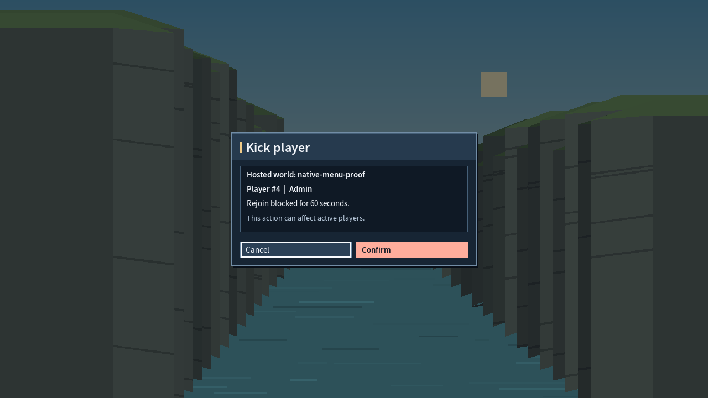
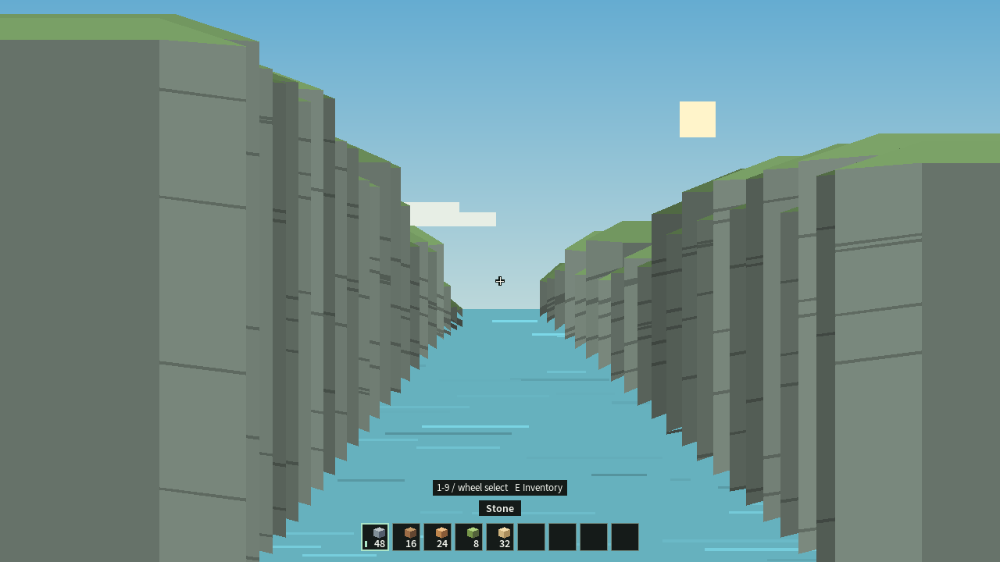
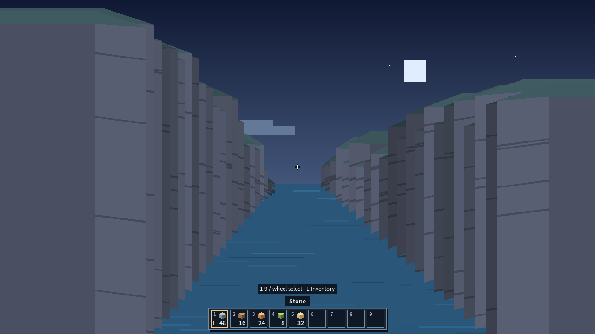
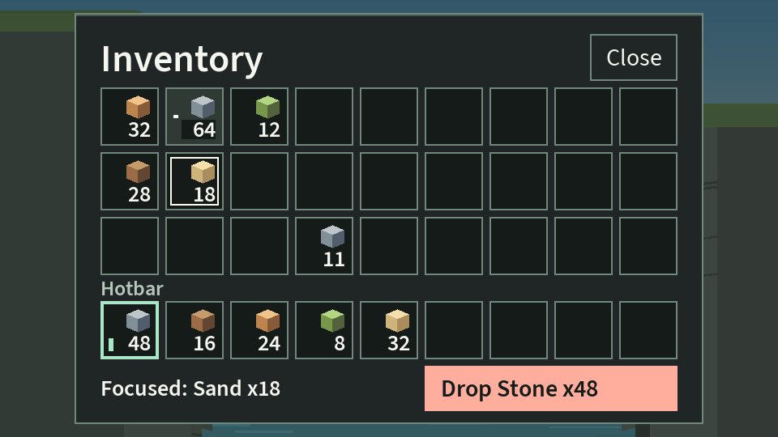

# ft_vox player UI visual direction

[Epic #325](https://github.com/gkehren/ft_vox/issues/325) · [Phase A #326](https://github.com/gkehren/ft_vox/issues/326) · [Epic #298 closure](game-ui-closure.md) · [Current design system](game-ui-design-system.md)

**Slate is the approved direction.** The maintainer selected “Slate, the restrained
graphite direction” in the Phase A review conversation on 2026-11-28.
Slate is the reference for Phase B (#327) and
the later screen passes. The live token contract remains in the current design
system until the tokens are implemented.

## Audit of the running UI

The native captures come from Epic #298 and #304. Menu and Settings observations
also use the local #309 Release proof outputs listed in the reproduction table.
The concept screenshots below use a common illustrative scene. They show design
choices at matching conditions across the two proposals.

| Screen | What the baseline shows | What Slate should improve |
| --- | --- | --- |
| HUD | The reticle already uses light and dark tones drawn with four rectangles. Thin strokes can be hard to see against the pale sky. At night, empty slots recede into the scene. The existing content-aware contrast plates group hints and selected-item text, whose type is small in these captures. [Day](images/game-ui-closure/player-hud.png) · [Night](images/game-ui-closure/player-hud-night.png) | Tune the existing reticle colors and thickness, and refine plate opacity, geometry and typography. Give the shared HUD slots an independent selection marker. Preserve the projection center and dock-safe area. |
| Inventory | Shared slot components already paint the square grid and hotbar. The header and instructions compete with the grid at 100%, and fine borders carry several state cues. The 200% capture makes it easier to distinguish them. [Standard](images/game-ui-inventory/normal-16x9.webp) · [Held stack](images/game-ui-inventory/held-21x9.webp) · [Compact](images/game-ui-inventory/compact-2x.webp) | Refine borders and counts in the shared slot component, and give selection and state independent markers. Keep the held stack and tooltip anchored to the existing input modality and viewport. Label the focused item separately from the drop action. |
| Launch, Local worlds, Pause | The local `launch.png`, `world-selection.png` and `pause.png` have compact panels and clear outlines. A centered label and similar button treatment give routine navigation, the primary action and utilities almost equal weight. A single saved world sits above several empty rows. | Give each screen a clear task title and primary action. Use a predictable single column and left-aligned labels. Let world results grow within a bounded list and give an empty result its actual empty state. |
| Settings and display confirmation | In `settings.png`, captions and values mostly occupy the same centered text lane. Display, input and preferences look equally weighted. In `resize-preview.png`, requested and current values repeat in a small text block, while the countdown and safe action compete with neighboring text. | Group display and input fields. Align labels and values, with a stacked fit on narrow views. Show the countdown and current/requested values by hierarchy. Keep the safe Revert focus obvious while retaining the existing preview policy. |
| Multiplayer roster and confirmation | The guest roster leaves a large dark area below Back for a two-player snapshot. The read-only explanation, ping/sample age and role details are easy to overlook at compact size. Owner confirmation already shows the world, operation, target, lockout and impact, but assigns most of them the same text weight. [Guest](images/game-ui-closure/guest-roster.png) · [Owner](images/game-ui-closure/owner-kick-confirmation.png) | Size the roster to content up to its scroll limit. Distinguish name, role and freshness, and give the read-only explanation a stable place near the list. Lead with the operation and keep Cancel visibly focused. |
| Gallery | Dense adjacent samples ask the eye to distinguish button borders, validation, toasts and slot states at once. The crafting specimen and confirmation share strong borders with other cards, flattening the reading order. [Crafting specimen](images/game-ui-closure/crafting-gallery.png) | Group related states side by side on a neutral surface. Give each specimen enough room to show its label, focus, state collision and clipped tooltip. Use the same components for gallery and player screens. |
| Keyboard focus | The existing navigation, focus ownership and input modality policies already determine the focused control. Slot validation and focus can share one edge. [Controls and routing](game-ui-interaction.md) | Give focus its own inner ring. Keep the same focus order, ownership and gesture cancellation. |
| Atlas | The renderer already generation-tags block images and manages resource replacement and lifetime for both block and font images. [Renderer and resource lifecycle](game-ui-renderer.md) | Fit new typography into the existing font bake and replacement path. Keep block layer lookup, fallback and generation handling. |

## Comparing the proposals

Both mockups show the same 27 inventory cells, nine hotbar cells, stack counts,
hovered and focused cells, selected Stone, persistent solo pause actions and
owner kick confirmation for Player #4 in the same hosted world. Day and night use the same camera and
hotbar content. The inventory references informed the square-grid cadence and
the use of panel framing. [Minecraft inventory](https://minecraft.wiki/images/Inventory.png?9e5ea) · [Hytale inventory](https://cms-a.nodecraft.com/f/133932/1282x752/5f38869e53/hytale-inventory.png/m/1000x0/smart)

| Slate · restrained graphite (**approved**) | Strata · layered blue-slate |
| --- | --- |
| Thin single frame, square wells and a mint selection marker. The panel depends on spacing and text weight for structure. Its 388×340 logical footprint and 36-unit cells leave more scene visible. | Framed header rail, recessed group boundary, raised lower tray, gold accents and slot lips. The 406×344 logical layout uses 38-unit cells to make the sections easier to group at a glance. |
| Pause actions read in one column under Resume, grouped into World, Preferences and Utilities, with Exit separated below. The confirmation leads with the operation and preserves its context in one reading column. | Pause uses two columns under Resume, which reduces height but changes the scan path. The confirmation uses a separate inset for the same context. |
| HUD consists of individual dark cells and compact label plates. Less framing draws attention to the selected material and game world. | A shared hotbar tray and explicit key labels make controls more discoverable and increase the visual weight at the bottom of the view. |

| Matched specimen | Slate | Strata |
| --- | --- | --- |
| Inventory · 1280×720, 100% |  |  |
| Pause · 1280×720, 100% |  |  |
| Owner confirmation · 1280×720, 100% |  |  |
| Daylight HUD · 1280×720, 100% |  |  |
| Night HUD · 1280×720, 100% |  |  |
| Compact inventory · 960×540, 200% |  |  |
| Ultrawide inventory · 2560×1080, 150% | [Slate at full resolution](images/game-ui-direction/slate-ultrawide.png) | [Strata at full resolution](images/game-ui-direction/strata-ultrawide.png) |

Slate uses the space between the grid, hotbar and action row to show their
relationship. A future crafting or container surface can attach its own titled
slot group using the same pitch, with the player inventory below on compact
views or adjacent where width permits. The standalone inventory remains only
as large as its current contents, with room for real status feedback when it
arrives. Empty slots remain visible. A held stack uses the same cell silhouette,
count and atlas image, then flips and clamps to the visible game view.

### Inventory drop action

The inventory detail identifies keyboard or pointer focus as applicable.
In the specimens it reads **Focused: Sand x18**. The hotbar selection tab
identifies Stone, and the destructive button reads **Drop Stone x48**. The
drop action always targets the whole stack selected in the hotbar. Moving
focus to another inventory slot changes the detail alone. The existing
single-item shortcut and authorization rules still apply.

| View state | Action label and presentation |
| --- | --- |
| Ready with a selected stack | Use **Drop {name} x{quantity}** from the current confirmed selection. With a long name, ellipsize the name only and preserve the verb and quantity. Show the full item name and quantity in a tooltip on hover or keyboard focus. |
| Selected slot empty | Show disabled **Nothing to drop**. The focused detail can still name a populated inventory slot. |
| A submitted drop is pending | Show disabled **Drop pending** with the existing status feedback. Keep the confirmed stack and selection visible while waiting. Other pending operations keep the target label if available and use their own status explanation. |
| Interaction unavailable or a drop is disallowed | Keep the target label if the current session has a confirmed selected stack. Otherwise show disabled **Drop unavailable** when inventory is unavailable, or **Nothing to drop** for a confirmed empty selection. Explain the cause using the existing status or recovery region. A pending drop takes label precedence even if the incoming presentation no longer has a confirmed stack. |

The compact layout gives the action a dedicated 156-unit button and omits
supplemental shortcuts. If a smaller view needs more room for the verb and
quantity, stack the detail above the full-width action before reducing its
type. Display-name fitting only changes the label. The existing typed intent
still uses the selected hotbar slot.

### Multiplayer confirmation

Read the operation first, followed by the hosted world, target player and
role, then duration and consequences. The kick specimen shows **Kick player**,
**Hosted world: native-menu-proof**, **Player #4 | Admin**, a 60-second rejoin
block and the existing active-player impact. Cancel has initial keyboard
focus and a complete ring. Confirm retains the danger treatment and the
existing activation and authorization checks.

If the launch, session, player or permissions change, retain the captured
context where available and surface the existing instruction to go back and
review the action. Disable Confirm and keep Cancel reachable. Never
substitute another player or apply the captured action to a new session.
Wrap long world names and consequences within the body, breaking long
unspaced names at a glyph boundary. Keep the full identity available in the
scrollable body. At compact heights, scroll the body between the operation
heading and a pinned action footer. The duration and consequences can wrap
independently of the buttons. Stack the buttons when necessary with Cancel
first in reading and keyboard order. This is presentation guidance for the
existing eligible and stale states.

## Slate specification

### Color and contrast

Values are sRGB. Use the existing linear compositor to blend translucent layers.
Cards, slot wells, count backings and HUD labels in the mockups use opaque fills.

| Role | Value | Application |
| --- | --- | --- |
| Canvas, base surface | `#141A18`, `#202625` | Opaque menu backdrop where applicable, card face |
| Raised, control | `#2D3531`, `#303A35` | Hovered row or section band, secondary button |
| Sunken | `#151B19` | Inventory wells, tooltip and count plates |
| Operative border, quiet divider | `#70887D`, `#46594F` | Slot and control edges, decorative internal rules |
| Primary, secondary, disabled ink | `#F4F6EF`, `#B7C7BD`, `#96A69C` | Text hierarchy and disabled text |
| Selection / action, focus | `#ABE5C8`, `#FFFBEF` | Primary fill, selected accent and keyboard ring |
| On accent and danger | `#151B19` | Dark foreground on filled action buttons |
| Success, warning, error/danger | `#A4DAA8`, `#F3CE82`, `#FFAD9C` | Confirmation, degraded state and rejection or destructive action |
| Info, pending | `#A4CDEA`, `#C9BAED` | Neutral system message and waiting for a result |
| Modal scrim | `#0C1310` at 78% linear opacity | One dimming layer behind the top modal |
| HUD label backing | `#151B19` opaque | If a later proof warrants translucency, use at least 94% opacity |
| Reticle | `#FFFBEF` over `#0C1310` | Light 1-unit core over a 3-unit dark outline, centered on the projection |

The mockup converts the scene and scrim from sRGB to linear RGB, blends
`scene × (1 − opacity) + scrim × opacity` per channel over the opaque scene,
then encodes and rounds once to 8-bit sRGB. This matches the native linear
blend and sRGB output model for the scrim. The rest of the mockup uses
opaque UI fills and illustrative scene colors. Slate uses 78% to keep the
panel distinct while leaving both bright and dark scenes recognizable.
Strata uses 82%. As reference points, Slate maps pure white to
`#828282` and pure black to `#09100D`. A 50% black-over-white witness
encodes to `#BCBCBC`. HUD plates are independent of the modal scrim.

Require at least 4.5:1 for normal, secondary, disabled and count text and
3:1 for large text and operative edges or marks. The following ratios use
WCAG relative luminance on the specified colors and linear opacity where
stated. Use the individual pairs as Phase B test cases.

| Cue | Adjacent surface and contrast | Minimum |
| --- | --- | --- |
| Primary ink | Panel 14.12, well 16.03, raised 11.58, control 10.81 | 4.5:1 |
| Secondary ink and explanations | Panel 8.73, well 9.91, raised 7.16, control 6.69 | 4.5:1 |
| Disabled ink and slash | Panel 6.03, well 6.84, raised 4.94, control 4.62. Use secondary ink for the separate explanation. | 4.5:1 text, 3:1 slash |
| Resting and hovered slot edges | Rest against well 4.58. Hover against control fill 3.09. Surrounding panel 4.03 or raised surface 3.31. | 3:1 |
| Button boundaries | Operative border against surrounding panel 4.03, raised 3.31, well 4.58 or canvas 4.62. Accent and danger fills also exceed 3:1 against each surrounding surface. | 3:1 |
| Inner focus on slot, quiet and secondary controls, and fields | Against well 16.88, panel 14.87, raised 12.19, control 11.39 and resting rim 3.69. Use a gap of the slot fill between outer semantics and focus. | 3:1 |
| Focus on primary and danger fills | Use a well-color keyline between the fill and light focus ring. Keyline against accent 12.28 and danger 9.74, ring against keyline 16.88. | 3:1 |
| Selected rim and tab | Against well 12.28, panel 10.82, raised 8.87, hover fill 8.29. | 3:1 |
| Pending rim and dots | Against well 9.75, panel 8.59, raised 7.04, hover fill 6.58. | 3:1 |
| Rejected rim and exclamation | Against well 9.74, panel 8.58, raised 7.03, hover fill 6.57. | 3:1 |
| Filled action label | Well ink against accent 12.28 and danger 9.74. | 4.5:1 |
| HUD primary and secondary labels, opaque plate | Black or white scene gives primary 16.03 and secondary 9.91. | 4.5:1 |
| HUD primary and secondary labels, minimum 94% plate | Black scene gives primary 16.19 and secondary 10.01. White scene gives primary 8.06 and secondary 4.99. | 4.5:1 |

Measure HUD slot edges against their controlled interior fill. The scene
outside a slot can vary freely. Inspect bright and dark gameplay for the
dual-tone reticle and block icons in addition to the measured UI pairs.
Quiet dividers, frame highlights and optional disabled button outlines are
decorative. They may fall below 3:1 because they neither identify an
operable control nor communicate its state. Disabled status, its identifying
cue and any accompanying explanation still meet their respective targets.

### Type, spacing and icons

- **Face.** The concepts use Source Sans 3 Regular for labels and Semibold for
  titles and quantities. Use one family for body and display. Semibold, left
  alignment and square component geometry already give the UI a distinct
  hierarchy. A separate voxel display face would add atlas pressure and
  legibility risk for little benefit at compact size.
- **Roles at 100%.** Caption 13/16, count 14/17 Semibold, body 15/20, heading
  18/23 Semibold, title 24/30 Semibold (type size / line height). Keep digits
  right-aligned to the same inset, labels left-aligned, and the missing-glyph
  fallback. Screen and modal titles may wrap; tooltips, labels and editors
  retain their existing use-specific fit and clip rules.
- **Spacing and borders.** Use 2, 4, 6, 8, 12 and 16 logical units. Use 16
  for panel padding, 4 for slot gaps, 36 for square cells, 28–36 for action
  row heights and 12–24 between related groups. Use a 1-unit resting border
  and 2-unit selected or semantic edge. Use a complete 1-unit inner focus
  ring on slots and a 2-unit ring on controls, snapped at device resolution.
  Slots and outer frames are square. Keep the hotbar bottom inset at 14
  logical units, less only when the existing game-view fit requires it.
- **Icons.** Use live atlas layers for items. Interface marks use simple,
  square-ended strokes for pending dots, a reject mark and disabled slash.
  Pair semantic marks with a status label or tooltip where
  the control already has a text presentation. Keep the existing glyph and
  stale-atlas fallbacks. Empty wells carry no decorative icon.

### States and motion


[Strata state comparison](images/game-ui-direction/strata-states.png)

| State | Cue and priority |
| --- | --- |
| Rest and hover | Thin rectangular outline at rest. Hover lifts the well fill and shows a short tick in the interaction lane while the target stays in place. |
| Pressed | An extended tick in the same lane replaces the hover tick within fixed hit geometry. Release restores the ordinary visual state. |
| Selected and keyboard focus | Selection has an independent vertical tab at the lower left. Focus uses a complete inner ring separated from the outer edge by a well or hover-fill gap. Focus stays visible on explicit keyboard navigation. |
| Pending | Pending rim and three-dot mark with the current confirmed contents. A focused pending cell keeps its inner ring. Status text identifies the waiting state. |
| Rejected | Error rim and exclamation when a slot is identified, plus the existing rejection text. Other failures use the screen-level status region. A new state can clear this emphasis while retaining the message according to the existing feedback lifecycle. |
| Disabled | Dim the item silhouette and show the slash. Suppress hover, press and interactive focus cues. Keep the confirmed contents, quantity, selection tab and authoritative status. Keep the disabled reason readable and separate from pending feedback. |

At the authored 36-unit size, paint in this order:

1. Paint the well and outer edge. The outer 1–2 units belong to the selected
   or semantic rim. Precedence is rejected, pending, selected, then rest.
2. Paint the item silhouette in the upper-right 15×15 region. Place the
   quantity and its solid backing in the separate lower-right 21×12 region.
3. Paint the left rail. The top 10×9 region holds the reject mark or pending
   dots. The middle 7×6 region holds the disabled slash or hover/press tick.
   The bottom 3×8 region holds the selection tab regardless of outer-edge
   precedence. Rejected suppresses both the pending rim and dots.
4. Paint the complete focus ring last, at inset 3. Keep all content at
   inset 4 or farther so icons, counts and marks cannot cover the ring.
   A disabled slot suppresses the ring. An enabled visual pending or
   rejected slot may retain its existing focus indicator. This specimen
   does not grant an actionable pending slot or change input ownership.

| Compound state | Expected cue |
| --- | --- |
| Selected + Focused | Selection tab and complete focus ring |
| Selected + Pending | Selection tab and pending rim and dots |
| Selected + Disabled | Selection tab and slash, with no hover, press or focus cue |
| Pending + Focused | Pending rim and dots with complete focus ring |
| Rejected + Focused | Rejected rim and exclamation with complete focus ring |
| Selected + Pending + Focused | Tab, pending rim and dots, complete ring |
| Rejected + Pending | Rejected rim and exclamation only |
| Pending + Disabled | Pending rim and dots plus disabled slash |

The slot view remains a presentation contract. A pending slot displays
its confirmed contents and uses the existing action gate. Session-wide
availability, input ownership and typed requests retain their existing
behavior. Immediate input and confirmed
state changes are the baseline. If Phase E adds motion, limit it to optional
80–120 ms fill or opacity feedback, with a zero-duration path. Keep focus,
confirmation timers, selection, held-stack anchors and result updates
immediate. Avoid positional motion on controls, attention loops, blur and
changes to hit regions or modal priority.

### Fit and overflow

These dimensions are logical. Resolve the existing scale once at the frame
boundary. Use the same computed rectangles for interaction and paint.

| View | Inventory and HUD | Menus, forms and dialogs |
| --- | --- | --- |
| 1280×720 and 1920×1080, 16:9 | Center the standard 388×340 inventory. The HUD keeps the projection-centered reticle and centers the hotbar in the safe game view. | One centered action column. Keep title and bottom modal actions visible. Scroll bounded lists and dense forms within the panel. |
| 2560×1080, 21:9 | Keep the nine-column grid and 388-unit authored width at 100/150/200%. Extra width is scene space. An occupied developer dock can narrow the HUD's available game view. | Keep readable line lengths. Wide windows can accommodate a paired label/value lane or a future additional slot group where content warrants it. |
| 960×540 | At fixed 200%, the available 480×270 logical box fits a 388×254 compact card. Tighten section gaps and omit supplemental shortcut copy. The nine cells remain full-size in each row. | Stack label/value lines when needed. Keep primary, cancel and back actions reachable through bounded scrolling or a pinned footer. Wrap and scroll confirmation details so the target, consequence and safe action stay readable. |

| Logical window before UI scaling | 100% | 150% | 200% |
| --- | --- | --- | --- |
| 960×540 | Standard | Standard | Compact |
| 1280×720 | Standard | Standard | Standard |
| 1920×1080 | Standard | Standard | Standard |
| 2560×1080 | Standard | Standard | Standard |

Fit a long focused item label within its detail lane and keep the drop
verb and quantity visible using the rules above. Give readiness or
rejection feedback priority over supplemental help. At compact height,
put multiline feedback in a bounded, scrollable body with focus reveal,
and pin Close and the drop action. Keep the held stack attached to the
existing pointer or keyboard anchor, flip it inward at the view edges
and clamp it inside the available game view. On views smaller than the
compact card retain the square grid-fit fallback, shrink the held preview
only as needed for the viewport, and keep tooltips within the same bounds.

The generator validates all twelve inventory configurations for each
proposal. These static checks assert panel and text bounds, slot shape
after pixel rounding, and separation among hit-shaped controls and the
occupied paint regions. Phase B must run all twelve configurations
through the native path for layout, pointer and keyboard targets,
long labels, live feedback, held-stack placement, device density and
ready, pending, rejected and disabled transitions. The shipped concept
PNGs sample three of those configurations.

## Phase B integration and budget

| Existing seam | Migration plan and review risk |
| --- | --- |
| [`PlayerUiStyle.hpp`](../src/Engine/PlayerUiStyle.hpp) | Replace the single baseline palette, role sizes and pixel metrics. Add dim, outer status and inner focus roles only where a common component consumes them. Test adjacency and compound state precedence. |
| [`PlayerUiText.hpp`](../src/Engine/PlayerUiText.hpp), [`PlayerUiFonts.*`](../src/Engine/PlayerUiFonts.cpp) | Prototype the pinned Source Sans 3 regular and semibold coverage in the current bake path. Pack both weights in one bounded atlas with the same supported glyph range, keeping glyph selection, metrics, clipping, hit-testing, caret and IME anchors consistent. Measure coverage size and density rebuilds before shipping. Keep the current working atlas if replacement fails. |
| [`PlayerUiComponents.*`](../src/Engine/PlayerUiComponents.cpp), [inventory layout](../src/Engine/PlayerInventory.cpp) | Draw borders, count plate, markers and hover through the existing shared Surface and SlotView. Reflow the responsive layout once for both painting and hit tests. Keep existing controls, slot identity, held-stack placement and typed intents. Verify the smaller header and footer leave space for tooltip and status. |
| [`PlayerUiGallery.*`](../src/Engine/PlayerUiGallery.cpp), [`GameUiGallery.cpp`](../src/Engine/GameUiGallery.cpp) | Make the gallery the specimen for the approved roles, shared state combinations and existing crafting preview. Confirm at 200% and compact size. |
| [Existing atlas and draw list](game-ui-renderer.md) | Keep layer 0 valid and generation checks and lifetimes intact. Use solid quads and current glyph masks for highlights, the reticle and UI marks. Frame counts and clips need measurement because per-slot clips can split batches. The current primitives cover the approved treatment. |

Slate's count plate and selection mark add at most a few bounded quads per
cell, and status marks apply only to affected cells. Reuse the existing four
reticle rectangles and the content-aware label backings. Keep contiguous
content on a shared scissor when it can be drawn safely. The draw list
allows 2,048 quads and 31 batches and reserves a
draw for UNORM encoding. Phase B must verify zero dropped instances, the
existing resource-lifetime envelope and the budgets below, including glyph
coverage at 200%. There is no resource measurement from the static mockups.

| Mode | #322 p95 UI CPU / GPU | #322 peak | ADR ceiling p95 UI CPU / GPU / draws |
| --- | --- | --- | --- |
| HUD | 0.0130 / 0.0041 ms | 1 draw, 936 vertices | 0.25 / 0.20 ms / 8 |
| Inventory | 0.0234 / 0.0236 ms | 1 draw, 3,072 vertices | 0.50 / 0.35 ms / 32 |

Track the new atlas dimensions and bytes, peak vertices, descriptors, dropped
instances and allocation recovery against [#322 timing](game-ui-closure.md#release-timing-on-the-rtx-4070-ti).
Avoid per-frame atlas regeneration, device waits and unbounded allocations.
Keep engine, gameplay, network and save data outside the visual token change.

## Asset provenance and reproduction

The concept scenes, item silhouettes, marks and panels are original geometry
drawn by [the mockup renderer](images/game-ui-direction/render.py) under the
project's Apache-2.0 license. The two external screenshots are linked reference
material. The concepts use their own terrain and silhouettes, and the game
continues to use its existing resource-pack atlas. Existing baseline captures,
the bundled pack and the embedded ProggyClean face retain their documented
attribution. [Third-party notices](../THIRD_PARTY_NOTICES.md)

The rasterized text uses [Adobe Source Sans 3 release 3.052R](https://github.com/adobe-fonts/source-sans/releases/tag/3.052R)
at `ed1808970eb3c7301c9a523bee26473ba0bb62fa`, under the [SIL OFL 1.1](https://github.com/adobe-fonts/source-sans/blob/ed1808970eb3c7301c9a523bee26473ba0bb62fa/LICENSE.md).
The PNGs contain rendered text. The TTF files are local reproduction inputs.
If Phase B distributes font binaries, ship Adobe's copyright and OFL text
with them, add the pinned source to the third-party notices, and review
reserved-name requirements before distributing any modified build.

From the repo root with Python and Pillow 12.3.0, download the two pinned
unmodified TTFs and regenerate to an isolated directory. The SHA-256 values
are recorded for reproducibility. Different FreeType builds may vary at
antialiased glyph edges.

```powershell
$fontDir = Join-Path $env:TEMP 'ft-vox-326-fonts'
New-Item -ItemType Directory -Force $fontDir | Out-Null
$source = 'https://raw.githubusercontent.com/adobe-fonts/source-sans/ed1808970eb3c7301c9a523bee26473ba0bb62fa'
curl.exe -LfSs "$source/TTF/SourceSans3-Regular.ttf" -o "$fontDir/SourceSans3-Regular.ttf"
curl.exe -LfSs "$source/TTF/SourceSans3-Semibold.ttf" -o "$fontDir/SourceSans3-Semibold.ttf"
Get-FileHash "$fontDir/*.ttf"
python docs/images/game-ui-direction/render.py --fonts $fontDir --out build/ui-direction-mockups
python docs/images/game-ui-direction/render.py --fonts $fontDir --validate
```

| Input | SHA-256 |
| --- | --- |
| Regular | `4644c81b86ec9caaa76b634889968ed3c4f4f52f054855933acc7c2b21e53b0f` |
| Semibold | `a3f4f8dcf343a8f24dc61951de93f3ba1558b15cd250ba24af8a40e957081b7d` |

For native reproduction, build the Release game, server and `test_engine_reload`
and use the [closure environment and commands](game-ui-closure.md#reproduce).
Store future before/after captures for a visual implementation from the same
seed, camera, visibility, resource pack, extent, player scale, device density
and input state. Keep scene-only screenshots and goldens independent.

| Baseline | Native proof argument or procedure |
| --- | --- |
| HUD day/night and dock | `--player-hud-proof <out>` writes the two HUD PNGs and workspace PNG |
| Inventory 16:9, ultrawide held stack, compact 2× | `--player-inventory-proof` prints `INVENTORY capture=` frame markers. Capture those presented frames as in the [inventory verification](game-ui-migration.md#inventory-verification). |
| Launch, World selection and Pause | `--session-menu-proof <out>` writes `launch.png`, `world-selection.png` and `pause.png` |
| Settings and display preview | `--player-settings-proof <out>` writes `settings.png` and `resize-preview.png`. The restart proof checks persisted settings. |
| Owner confirm and guest roster | [Two-client native closure](game-ui-closure.md#reproduce), `--full-ui`, writes `owner-kick-confirmation.png` and `guest-roster.png` |
| Gallery and scale specimens | `--game-ui-design-system <out>` writes standard, ultrawide and compact specimens and `crafting-gallery.png` |
| Attributed rendering timings | `--game-ui-performance` with the closure timing flags and RTX 4070 Ti baseline |

**Executed in Phase A.** Reviewed historical native captures. Regenerated
all 16 PNGs byte-for-byte and inspected both concepts, including compound
states and bright and dark samples. Verified the contrast matrix using
sRGB luminance calculations. The generator validated 24 inventory layouts,
long and unavailable drop labels, compact confirmations, unbroken focus
perimeters for compound states and linear-light witnesses. The existing
Windows Release CPU build passed `GameUiDrawList`, `GameUiInteraction`,
`GameUiStyle`, `GameUiComponents` and `MultiplayerUi`.

**Deferred to production implementation.** Fresh native Vulkan fixtures,
graphics builds, sanitizers, GPU timing and matching runtime before/after
captures remain Phase B verification work. The illustrative previews do
not measure runtime behavior, accessibility or performance.
