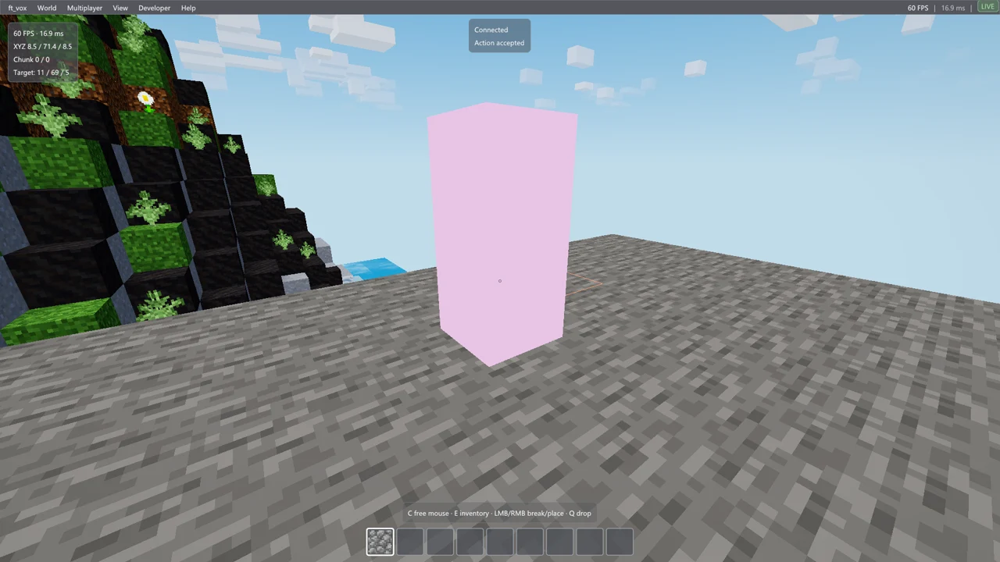

# Graphical multiplayer smoke for #257

The Windows Release client ran on an NVIDIA GeForce RTX 4070 Ti with two
game processes and one IPv4 loopback server. The world used seed 42 and a
small stone platform prepared with the headless runner, so the camera
and both players started above the water. A temporary diagnostic build
sent movement and actions through the graphical client's usual
submission methods and read back the displayed Vulkan frame. The
diagnostic input and readback code are outside the shipped client.

- Two distinct player IDs joined the same world and epoch. One player
  walked away from the shared spawn, and each client rendered the other
  avatar from its own viewpoint.
- Client A broke the stone at `(8, 69, 8)` and collected one
  cobblestone. Client B saw the same cell turn to air and still had an
  empty inventory. A placed the collected item and its inventory
  returned to empty. B then broke another block and collected its own item.
- After an orderly server stop, both running windows reported zero
  chunks and zero draw entries. The dedicated server checkpoint saved
  the edits. A restart of the same save followed by reconnect gave
  both clients a new session scope and render epoch in the same processes.
- A client expecting seed 43 refused the seed-42 server. A client pointed
  at a vacant UDP port timed out. Both windows stayed open with zero
  chunks and zero draw entries, and the client offered reconnect.

The Windows CPU-only suite passed 38 tests. The existing loopback tests
cover interest exit and return, packet loss, revision gaps, generator
compatibility, private inventory, and distinct action results.
`WorldReplication` also checks a replica chunk's occupancy and seam
after a delta, retirement while a worker holds a lease, and re-entry
with a new verified image. The Windows Vulkan `EngineReload` and
`VisualRegression` smoke tests passed, and a five-second solo benchmark
completed and wrote its report. The interactive window run
reported the existing swapchain validation warnings documented in the
[Vulkan validation guide](vulkan-validation.md).

See the [server guide](dedicated-server.md#connect-two-graphical-clients)
for the normal two-process commands and keyboard controls.
